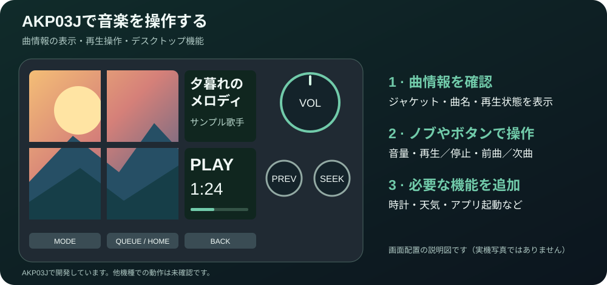

# Stream Dock Now Playing

[English](README.md)

**AKP03Jで、Spotifyの曲情報を確認したり、再生・停止・音量調整をしたりできるWindows用の追加ソフトです。**

6個の小型画面にアルバムのジャケットや曲名を表示し、ノブ（回すつまみ）やボタンで操作します。
作業中にSpotifyのウィンドウを開く必要がありません。
音量を操作するには、導入後に対象アプリの設定が必要です。

## AKP03Jはどんな機器？

**AJAZZブランドの「AKP03J」というUSB接続の操作機器**を使います。
画面付きボタンが6個、回転ノブが3個、通常のボタンが3個あります。
機器は別途必要で、このリポジトリで配布しているのは追加ソフトです。

**[実物の写真・製品説明を見る（AJAZZ公式ストア）](https://store.shopping.yahoo.co.jp/ajazz/akp03j.html)**
／ [商品写真だけを開く](https://item-shopping.c.yimg.jp/i/n/ajazz_akp03j)

リンク先はアジャズジャパン株式会社が運営する公式ストアです。
商品写真はリンク先で閲覧する形にし、このリポジトリには転載していません。
公式写真は製品の外観を示すもので、本ソフトを動かした画面ではありません。
本ソフトはAJAZZやSpotifyの公式製品ではありません。

開発・動作確認に使っているのはAKP03Jです。Stream Dock AJAZZ上では
`AJAZZ AKP03E_3220` と表示されます。他の型番での動作は確認できていません。

## 何ができる？

| 使い方 | できること | 追加設定 |
|---|---|---|
| 音楽を操作する | ジャケット・曲名の表示、再生／一時停止、前曲／次曲、曲内の早送り・巻き戻し | 基本動作はSpotifyの追加認証なしで試せます。アプリごとに対応範囲が異なります |
| 音量を変える | PC上のSpotify等のアプリ音量、大ノブでの操作 | 対象アプリを設定します |
| 次の曲を選ぶ | 次に再生される曲の一覧（Queue）、お気に入りの曲、プレイリスト、曲・アーティスト・アルバムの詳細 | Spotify Developer登録と本人の認証が必要です。アカウント・APIの制限があります |
| デスクトップの道具として使う | 時計・日付、天気、洗濯物の外干しの目安、アプリやWebサイトの起動 | 地域・起動先などを設定します |
| YouTubeを操作する | 動画一覧からの選択、再生操作、再生速度の調整、小型画面への動画表示 | Chrome拡張などの設定が必要な非公式実験機能です |

Spotify APIやYouTubeの機能は、初期状態では無効です。
まずは追加認証なしで音楽の基本操作を確認してください。
おすすめプレイリストは登録したリンクを使う方式で、Spotifyのホーム画面そのものを取得する機能ではありません。

### 音楽画面の配置

図はオリジナルのサンプル画像を使った説明用です。実機写真や実演動画ではありません。

- 左側の4画面：1枚のジャケット画像を大きく表示。
- 右上：曲名とアーティスト名。
- 右下：再生／一時停止の状態、再生時間、音量などの操作結果。
- 大ノブ：音量調整。押すと再生／一時停止。
- 左小ノブ：前曲／次曲。右小ノブ：曲内の早送り・巻き戻しや、一覧の移動。

ジャケットや曲情報の画面を押すと、6画面を使った詳細表示を開けます。
YouTubeでは右小ノブを押してから回すと再生速度を調整できます。
5秒間操作しないと通常の早送り・巻き戻し操作へ戻ります。[詳しい速度操作](docs/YOUTUBE_SPEED.md)

## まず試すには

必要なのは **Windows 11、AKP03J、Stream Dock AJAZZ、Python 3.12以降**です。
Stream Dock AJAZZは機器を動かすためのソフトで、本ソフトはその中で動きます。
Pythonは本ソフトを実行するために使います。

**[追加認証なしで試す手順 →](docs/QUICKSTART.ja.md)**

最初の確認は、PC上のSpotifyデスクトップ版で曲を再生し、ジャケット表示とPlay/Pauseを試します。
この段階ではSpotify Developer登録・Client ID・OAuth・APIキー・Chrome拡張は不要です。
普段Spotifyを使うためのログインは必要です。「追加認証なし」は開発者向けの連携設定が不要という意味です。
配布されているのは開発中のソースコードで、インストーラー付きの完成版ではありません。

導入補助ツールは既存プラグインや設定を上書きせず、新しいプロファイルを作成します。
プロファイルとは、ボタンの割当や画面の配置をまとめた設定です。
別PCへの新規導入はまだ実機確認待ちなので、元のプロファイルを残して試してください。
設定変更は現在JSONファイルの編集方式で、設定画面はまだありません。

## 使う前に知っておきたいこと

- 動作確認はAKP03JとWindows 11の開発環境で行っています。他機種・Mac・Elgato Stream Deckへの対応は保証していません。
- 基本の曲情報と再生操作には、Windowsのメディア連携機能（GSMTC）を使います。表示や操作の可否はプレーヤー次第です。
- Spotifyの次曲一覧や外部スピーカー操作（Spotify Connect）は追加機能です。利用できるアカウント・権限・機器に制限があります。
- YouTubeのページ解析・動画転送などは非公式の実験機能で、サービス利用条件との整合性が未確認です。ソース公開が利用の許可を意味するわけではありません。
- ソースコードのMITライセンスは、商品写真・音楽・動画・ロゴや、外部サービスの利用権を含みません。

[既知の制約](docs/KNOWN_LIMITATIONS.md) · [外部サービスの条件](docs/SERVICES.md) ·
[個人情報の扱い](PRIVACY.md) · [ライセンス](LICENSE)

## 設定・困ったとき

- [最初の導入と確認（日本語）](docs/QUICKSTART.ja.md)
- [詳しい導入・設定・削除手順（英語）](docs/INSTALL.md)
- [アプリ起動先とアイコンの設定（英語）](docs/APP_LAUNCHERS.md)
- [元の環境へ戻す手順（英語）](docs/MIGRATION.md)
- [変更履歴（英語）](CHANGELOG.md)

Steam・LINE・Codexなどのアプリは、利用者が起動先を登録します。
初期状態のアプリ枠は未設定のAPP 1〜3で、本体やアプリのロゴは同梱していません。

## AKP03Jを持っている方へ

別の所有者のPCでも導入できるか、確認に協力してもらえると助かります。
[実機確認の報告](https://github.com/afuro77/streamdock-now-playing/issues/new?template=hardware_trial.md)へ、
機種・Stream Dock AJAZZのバージョン・導入結果・困った点を記入してください。
認証情報・個人用の保存先・設定フォルダーは添付しないでください。

英語READMEを正文とします。[公式製品情報と画像の出典](docs/HARDWARE.md)も確認できます。
