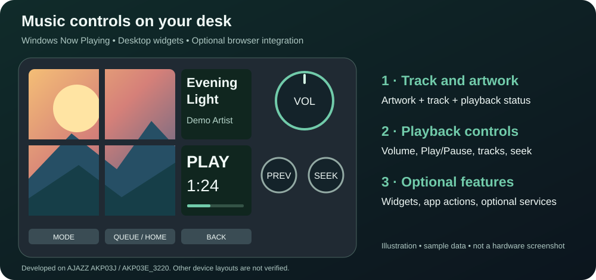

# Stream Dock Now Playing

[日本語](README.ja.md)

**Use an AJAZZ AKP03J to see what is playing and control Spotify from your desk.**

The device's six small screens show album artwork, track information and playback
status. Its knobs and buttons control playback, track changes, seeking and volume,
so you can keep working without opening the Spotify window. Application volume
needs an audio mapping after installation.

## What is an AKP03J?

The **AJAZZ AKP03J** is a separate USB desktop controller with six LCD buttons,
three rotary knobs and three ordinary buttons. This repository provides software
for it; the hardware is not included.

**[See the actual device: photos and specifications at the AJAZZ official store](https://store.shopping.yahoo.co.jp/ajazz/akp03j.html)**
· [Open the store's product photograph](https://item-shopping.c.yimg.jp/i/n/ajazz_akp03j)

The Japanese store is operated by AJAZZ JAPAN (アジャズジャパン株式会社).
Product photos are linked at their source, not copied into this repository. They
show the manufacturer's product, not this project's running software. This is an
independent project, not an official AJAZZ or Spotify product.

Development uses an AKP03J, identified as `AJAZZ AKP03E_3220` by Stream Dock AJAZZ.
Other model names do not establish compatibility. See [hardware sources](docs/HARDWARE.md).

## What appears on the screens?



*Screen-layout illustration with sample data. For real product photographs, use
the official-store links above. A recording of this software on hardware is not
available yet.*

- Four screens on the left show one album cover.
- Top right shows the track and artist. Bottom right shows playback state, elapsed
  time and temporary operation feedback.
- The large knob controls volume and Play/Pause. The small knobs control track
  changes, seeking or list navigation, depending on the current screen.
- Press artwork or track information to open a full-device detail view.

## Try basic music controls first

**[First-install guide →](docs/QUICKSTART.md)** · [日本語で導入](docs/QUICKSTART.ja.md)

Start with Spotify desktop playing on the PC. Album artwork and basic playback
controls use Windows' built-in media-session interface (GSMTC), so this first test
needs **no Spotify developer account, Client ID or OAuth authorization**. Player
support varies. Volume requires a configured application mapping.

You need Windows 11, Python 3.12+, the separate Stream Dock AJAZZ host application
and the device. This plugin runs inside that host; it is not a replacement driver.
The host profile contains the button assignments and screen layout.

**Experimental source preview (`1.2.0.dev1`).** There is no standalone installer
or settings GUI yet; settings are edited as JSON. Clean-PC hardware installation
still needs verification. Keep your original profile so you can switch back.
No host binaries, credentials, private settings, app logos or copyrighted media
are distributed.

## Three modes

| Mode | Features | Status |
|---|---|---|
| Spotify / Media | Artwork, track information, playback and app volume. Optional Spotify authorization adds the next-up queue, liked songs, playlists, track details and control of Spotify Connect speakers | Basic controls tested locally; additional features depend on account permissions and platform limits |
| Desktop | Clock/date, weather, outdoor laundry guidance, app/website launch buttons and Windows master volume | Tested on the development device; set your own location and launch targets |
| YouTube | Video lists, playback/speed controls and video display across six LCDs; requires a Chrome extension | **Unofficial browser experiment; see restrictions below** |

Normal media layout is four artwork LCDs plus track information and playback
status. Artwork/details expand on press. YouTube lists show three selectable
columns: text above, thumbnail below. Desktop's default bottom row contains three
unconfigured app actions; Steam/LINE/Codex are user settings, not required apps.

### External services are separate from the code license

The MIT license applies to this project's source, **not** Spotify/YouTube content,
logos, service access or third-party software. Spotify embed-page parsing and
YouTube DOM/HTML/website-continuation/canvas paths are undocumented experiments.
Their policy compatibility is unresolved; publishing their source is not a claim
that their use is authorized. A warning or opt-in does not override service terms.
Do not use them where you lack permission. See [service notes](docs/SERVICES.md).
Spotify API and YouTube integrations are disabled in the supplied default config.

YouTube playback speed: press the right small knob, rotate to adjust, and wait five seconds to return to seek. See [speed controls](docs/YOUTUBE_SPEED.md). Reload extension **0.4.10** and the YouTube tab after updating.

## Start here

1. Follow the [first-install guide (no Spotify API credentials needed)](docs/QUICKSTART.md).
2. With the host closed, run `python tools/quickstart.py --check`, then
   `python tools/quickstart.py --install` from a fresh extracted source folder.
3. Start the host, select **Now Playing OSS Preview**, and test artwork + Play/Pause.
4. Add [app actions](docs/APP_LAUNCHERS.md) and [optional integrations](docs/INSTALL.md)
   after basic playback works. See [removal](docs/INSTALL.md#uninstall) for rollback.

The helper refuses existing installations and never stops the host automatically.
It is not an updater. Keep the source folder in place. See the full guide for
existing Python environments, nondefault host paths or a partially failed setup.

### Help verify another AKP03J

The first goal is a successful install by another owner. Please report your exact
model/host version, installation result, artwork and Play/Pause result using the
[hardware-trial template](https://github.com/afuro77/streamdock-now-playing/issues/new?template=hardware_trial.md).
Clean-PC installation remains unverified; no broader compatibility is claimed.
Please exclude tokens, local paths, runtime folders and private media.

The deployment namespace is `org.streamdock.nowplaying.public`. It is distinct
from stable v1 and the private DEV installation; existing profiles are not edited.
Profile import/device assignment and clean-machine installation remain experimental.
Keep a working profile and use the [migration/rollback guide](docs/MIGRATION.md).

## Compatibility

| Device / host | Evidence |
|---|---|
| AJAZZ AKP03J / AKP03E_3220, 6 LCD + 3 encoders + 3 lower keys | Development-device operation verified |
| Stream Dock AJAZZ on Windows 11 | Development host verified |
| Other Stream Dock compatible hardware / Windows 10 | Not verified; layout/events may differ |
| Elgato Stream Deck | Not verified or claimed compatible |

| Player / route | Evidence / limits |
|---|---|
| Spotify desktop | GSMTC playback/artwork and app-volume operation verified |
| Spotify Connect / Google Home | API device/volume path; depends on device capabilities and authorization |
| Chrome / YouTube | Browser GSMTC + experimental extension; multiple tabs can complicate session selection |
| Other GSMTC players | Provider interface supports them; actual control flags/artwork vary, not individually verified |

## Development checks

Python 3.12+ on Windows; Node.js is used only for extension tests.

```powershell
python -m venv .venv
.\.venv\Scripts\python.exe -m pip install -r requirements.txt
$env:PYTHONPATH = (Join-Path $PWD 'src')
.\.venv\Scripts\python.exe -m unittest discover -s tests -q
node tests/youtube-extension.test.mjs
node tests/youtube-browser-extension.test.mjs
node tests/youtube-channel-extension.test.mjs
node tests/youtube-measurement.test.mjs
```

The source preview retains the development regression suite. Fixture-based tests
do not prove hardware reliability, external endpoint availability or terms compliance.
See [known limits](docs/KNOWN_LIMITATIONS.md), [privacy](PRIVACY.md),
[contributing](CONTRIBUTING.md), [security](SECURITY.md) and [changelog](CHANGELOG.md).

## Module boundaries

| Responsibility | Modules |
|---|---|
| Media metadata/artwork | `media.py` (GSMTC) |
| App/master volume | `audio.py`, `master_audio.py`, `volume_router.py` |
| Media commands | `controller.py` |
| LCD layouts, overlays and lists | `renderer.py`, `queue_renderer.py`, detail renderers |
| Host transport/lifecycle | `streamdock.py` |
| Desktop widgets/actions | `desktop.py`, `launcher.py`, `desktop_navigation.py` |
| Optional service adapters | `spotify.py`, queue/library/detail modules, `youtube.py`, browser bridge and Chrome extension |

Host orchestration is still large and will be separated incrementally. No official
affiliation with AJAZZ, Mirabox, Spotify, Google, Valve, LINE or OpenAI is implied.

## License

[MIT](LICENSE) for own source. Dependency and SDK reference notices are listed in
[THIRD_PARTY_NOTICES.md](THIRD_PARTY_NOTICES.md). OS fonts and application icons are
not redistributed. The [publication review](docs/PUBLICATION_REVIEW.md) records
provenance checks, exclusions and unresolved service questions.
